<div align="center">

# SecPulse

**Audit de sécurité web passif — une URL, six analyses, une note de A à F et des correctifs concrets.**


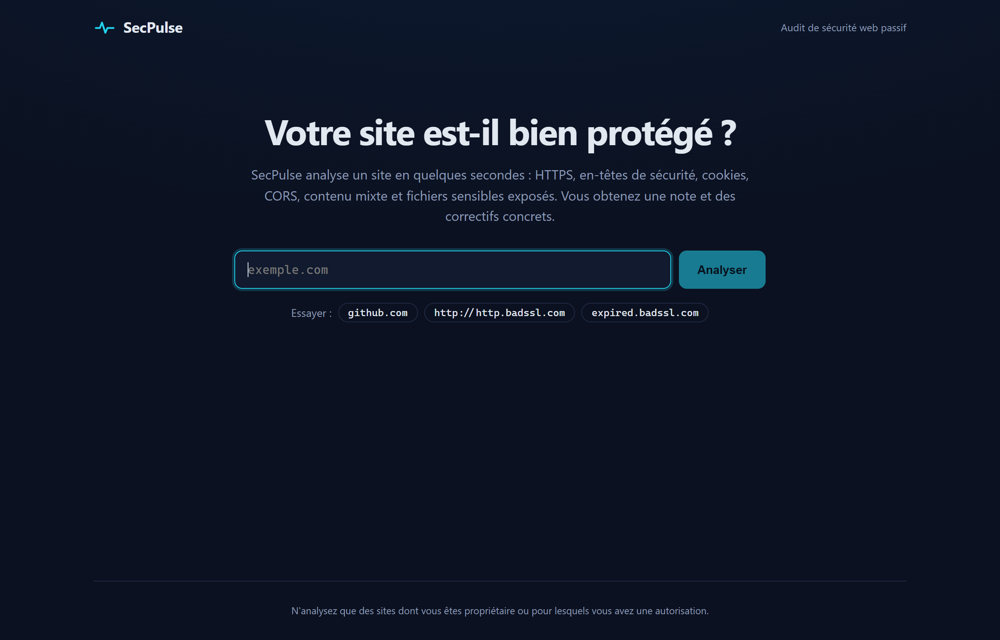

</div>

---

## Sommaire

- [Ce que fait SecPulse](#ce-que-fait-secpulse)
- [Aperçu](#aperçu)
- [Les six analyses](#les-six-analyses)
- [Architecture](#architecture)
- [Ce qui rend le projet non trivial](#ce-qui-rend-le-projet-non-trivial)
- [Calcul de la note](#calcul-de-la-note)
- [API](#api)
- [Installation](#installation)
- [Tests](#tests)
- [Structure du projet](#structure-du-projet)
- [Limites et pistes](#limites-et-pistes)

---

## Ce que fait SecPulse

On saisit l'adresse d'un site. En une à trois secondes, SecPulse :

1. **récupère la page** en suivant les redirections (HTTP → HTTPS, `domaine.com` → `www.domaine.com`) ;
2. **lance six analyses de sécurité**, dont trois en parallèle qui font leurs propres requêtes réseau ;
3. **calcule un score sur 100** et une note de **A** à **F** ;
4. **classe les problèmes par gravité** et propose pour chacun le correctif à appliquer (l'en-tête exact, la bonne valeur de cookie…).

L'analyse est **passive** : SecPulse se comporte comme un navigateur curieux. Il n'envoie aucune charge malveillante et ne tente aucune exploitation.

---

## Aperçu

### Un rapport complet

Le rapport commence par la note et le décompte des problèmes par gravité. Viennent ensuite les trois problèmes à corriger en priorité, puis le détail par catégorie. Les contrôles réussis restent repliables pour ne pas noyer l'essentiel.

<p align="center">
  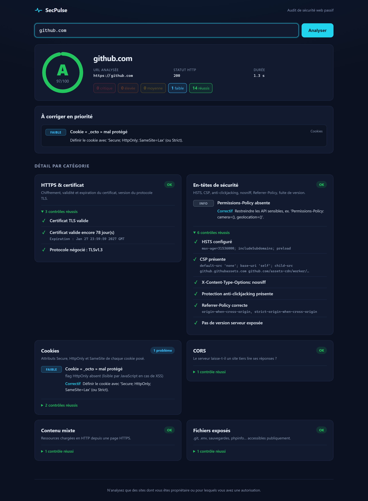
</p>

### Un site mal configuré

Un site servi uniquement en HTTP obtient **F**. Le problème critique (pas de chiffrement) arrive en tête, suivi des en-têtes manquants avec, pour chacun, la ligne de configuration à ajouter.

<p align="center">
  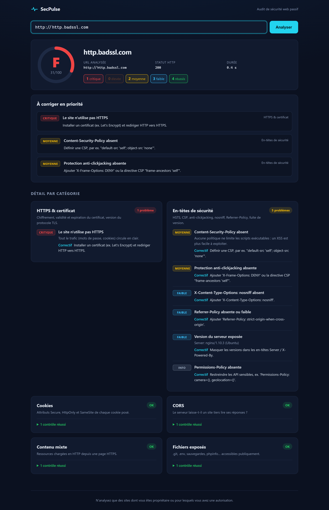
</p>

### Toute la gamme des notes

| Certificat expiré → **F** | Bonne configuration perfectible → **B** |
|:---:|:---:|
| 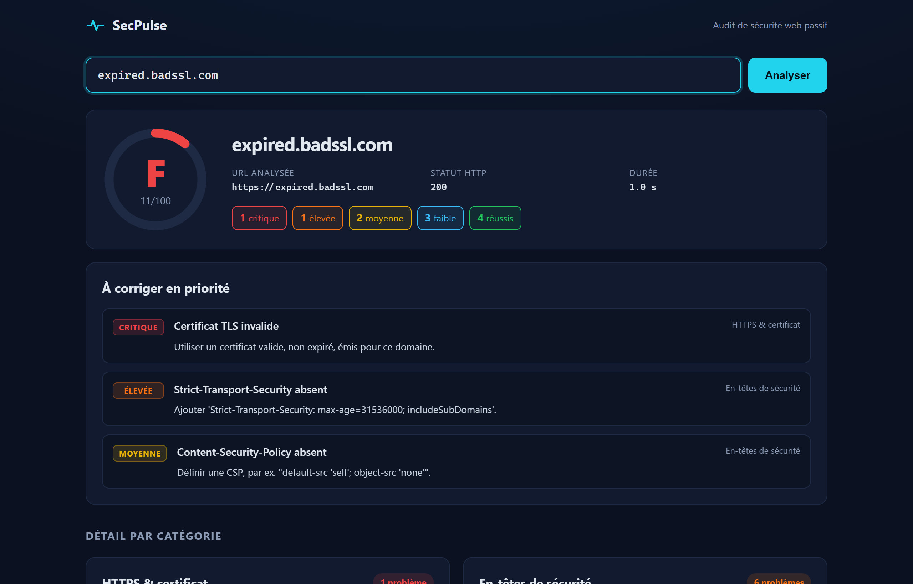 | 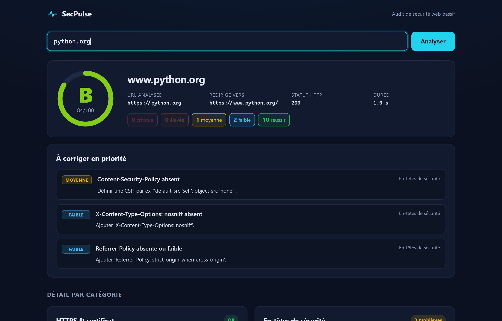 |
| Le certificat est vérifié séparément : la page est quand même analysée, et l'expiration est signalée comme critique. | La redirection `python.org` → `www.python.org` est suivie et affichée. |

### Pendant l'analyse, sur mobile, et face à une cible interdite

| Analyse en cours | Mobile |
|:---:|:---:|
| 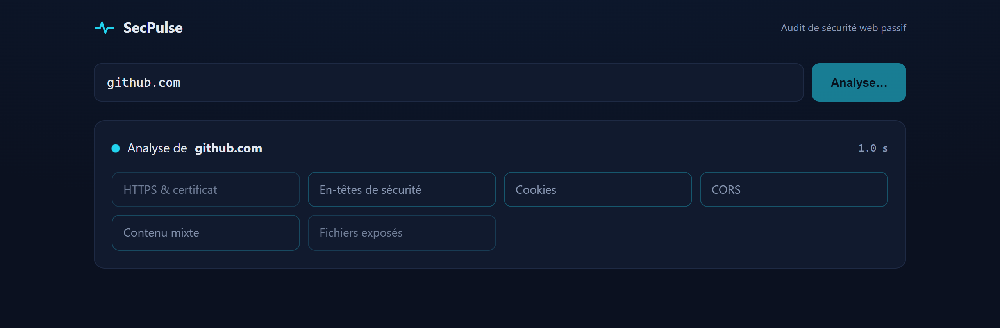 | 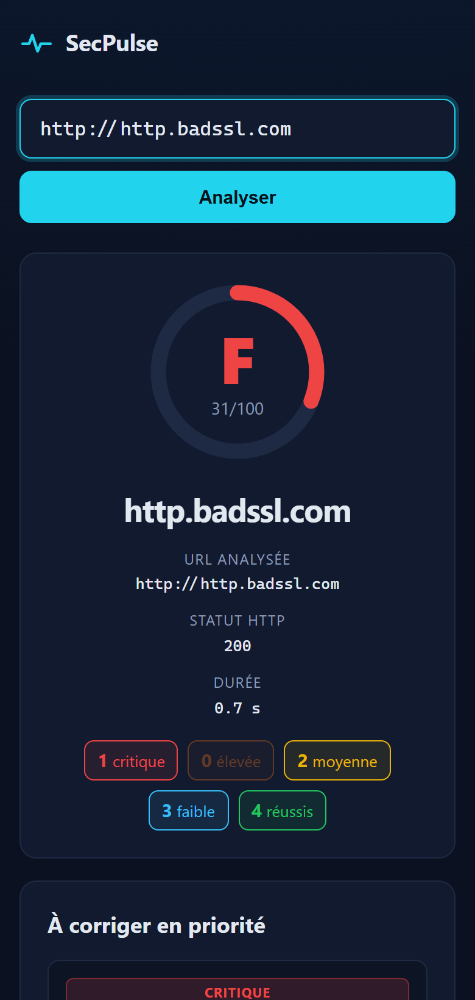 |

<p align="center">
  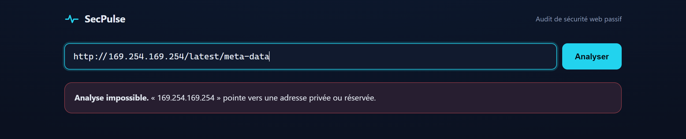
  <br>
  <em>Tentative de scanner l'adresse de métadonnées cloud <code>169.254.169.254</code> : refusée (voir <a href="#1-protection-ssrf">protection SSRF</a>).</em>
</p>

---

## Les six analyses

| Analyse | Ce qui est vérifié | Exemple de problème détecté |
|---|---|---|
| **HTTPS & certificat** | HTTPS utilisé, redirection HTTP→HTTPS, validité de la chaîne de certificats, jours avant expiration, version TLS négociée | `Certificat TLS invalide` — **critique** |
| **En-têtes de sécurité** | `Strict-Transport-Security` (et son `max-age`), `Content-Security-Policy` (et `unsafe-inline`/`unsafe-eval`), `X-Content-Type-Options`, `X-Frame-Options` / `frame-ancestors`, `Referrer-Policy`, `Permissions-Policy`, versions exposées dans `Server` / `X-Powered-By` | `Version du serveur exposée : nginx/1.10.3` — faible |
| **Cookies** | `Secure`, `HttpOnly`, `SameSite`, et le cas `SameSite=None` sans `Secure` (rejeté par les navigateurs) | `Cookie « session » : flag Secure absent` — moyenne |
| **CORS** | Requête envoyée avec une `Origin` étrangère : le serveur la reflète-t-il ? avec `Allow-Credentials` ? accepte-t-il l'origine `null` ? | `CORS reflète n'importe quelle origine avec credentials` — **critique** |
| **Contenu mixte** | Analyse du HTML : ressources chargées en `http://` sur une page HTTPS, en distinguant le contenu **actif** (scripts, iframes, CSS) du **passif** (images, médias) | `3 ressources actives en HTTP` — élevée |
| **Fichiers exposés** | 9 chemins sensibles sondés en parallèle : `.git/HEAD`, `.git/config`, `.env`, `backup.zip`, `backup.sql`, `wp-config.php.bak`, `phpinfo.php`, `server-status`, `.DS_Store` | `Dépôt Git exposé (code source téléchargeable)` — **critique** |

Chaque problème est classé selon cinq niveaux de gravité : `critique`, `élevée`, `moyenne`, `faible`, `info`.

---

## Architecture

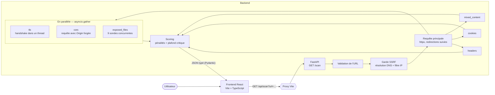

**Déroulement d'un scan**

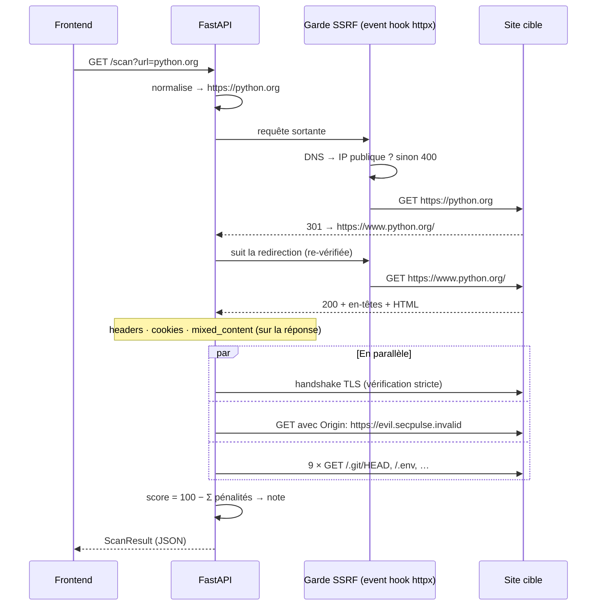

---

## Ce qui rend le projet non trivial

Un scanner naïf fait un `GET` et cherche quelques en-têtes. Les vrais problèmes apparaissent quand on le confronte à des sites réels.

### 1. Protection SSRF

Un service qui accepte n'importe quelle URL et va la chercher côté serveur est une cible classique de **Server-Side Request Forgery**. Sans protection, on pourrait lui demander de scanner `http://localhost:6379` (un Redis interne), `http://192.168.1.1` (l'interface d'un routeur) ou `http://169.254.169.254` (les identifiants d'une instance cloud).

SecPulse résout le nom d'hôte et **refuse toute adresse non publique** : privée, loopback, link-local, réservée, multicast, ainsi que les adresses IPv6 qui encapsulent une IPv4 (`::ffff:127.0.0.1`). La vérification est branchée comme **event hook httpx** : elle s'applique donc à *chaque* requête sortante, **redirections comprises**. Un site public ne peut pas rediriger le scanner vers le réseau interne.

```python
async def _guard_request(request: httpx.Request) -> None:
    # Appelé pour chaque requête, redirections comprises.
    await _assert_public_host(request.url.host)
```

### 2. Éviter les faux positifs sur les fichiers exposés

Beaucoup de sites (en particulier les applications React, Vue ou Angular) répondent **200** à *n'importe quelle* URL et renvoient leur page d'accueil. Un scanner qui se fie au code HTTP signalerait `.env` et `.git` exposés sur la moitié du web.

Chaque sonde vérifie donc **la signature du contenu** attendu :

| Fichier | Critère de détection |
|---|---|
| `.git/HEAD` | commence par `ref: ` ou est un SHA-1 de 40 caractères hexadécimaux |
| `.env` | lignes `NOM_VARIABLE=…` **et** pas de HTML |
| `backup.zip` | signature binaire ZIP `PK\x03\x04` |
| `.DS_Store` | octets magiques `Bud1` à l'offset 4 |

Seuls les 8 premiers Ko sont lus (en streaming) : le scanner ne télécharge pas une archive de 2 Go pour vérifier son en-tête.

### 3. Analyser un site dont le certificat est invalide

Si la requête HTTP vérifiait le certificat, un site au certificat expiré ferait simplement échouer le scan, et l'utilisateur n'aurait aucun rapport. SecPulse sépare donc deux choses :

- **la récupération du contenu** se fait sans vérification, pour analyser quand même les en-têtes et les cookies ;
- **la vérification TLS** se fait à part, par un vrai handshake `ssl` avec le contexte strict par défaut. C'est elle qui note l'invalidité du certificat comme **critique**.

Le module `ssl` étant bloquant, le handshake s'exécute dans un thread (`asyncio.to_thread`) pour ne pas bloquer la boucle d'événements.

### 4. Isolation des pannes

Un site peut répondre à la page principale mais laisser expirer la requête CORS, ou refuser les connexions sur un chemin donné. Chaque analyse est enveloppée : si l'une plante, elle apparaît avec un statut **Erreur** dans le rapport, et les cinq autres sont livrées normalement.

### 5. Analyse HTML robuste

La détection du contenu mixte utilise un vrai parseur HTML (`html.parser`) plutôt que des expressions régulières. Elle distingue `<link rel="stylesheet">` (actif, bloqué par le navigateur) de `<link rel="icon">` (passif) et traite les attributs `src`, `href`, `data` et `action` selon la balise.

### 6. Parsing correct des cookies et des en-têtes

- Les cookies sont lus via `headers.get_list("set-cookie")`. Un serveur envoie un en-tête `Set-Cookie` *par cookie* ; les concaténer avec des virgules casserait les dates `Expires=Wed, 21 Oct…`.
- Les directives CSP sont découpées proprement, si bien que `frame-ancestors` dans la CSP est reconnu comme protection anti-clickjacking, au même titre que `X-Frame-Options`.

---

## Calcul de la note

Chaque problème retire des points selon sa gravité :

| Gravité | Pénalité |
|---|---:|
| Critique | −40 |
| Élevée | −20 |
| Moyenne | −10 |
| Faible | −3 |
| Info | 0 |

**Règle du plafond critique :** dès qu'un problème critique est présent, le score est plafonné à **40**, quelle que soit la qualité du reste. Un site parfaitement configuré dont le dépôt `.git` est public ne doit pas obtenir B.

| Score | ≥ 90 | ≥ 80 | ≥ 65 | ≥ 50 | < 50 |
|---|:---:|:---:|:---:|:---:|:---:|
| **Note** | **A** | **B** | **C** | **D** | **F** |

---

## API

Le backend est utilisable sans le frontend. FastAPI génère une documentation interactive sur `/docs` :

<p align="center">
  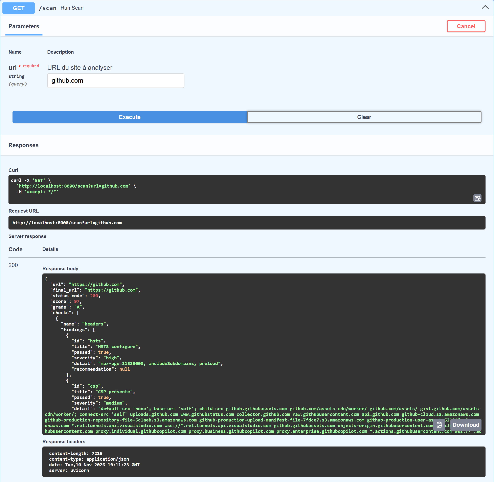
</p>

```bash
curl "http://localhost:8000/scan?url=github.com"
```

<details>
<summary>Exemple de réponse (abrégée)</summary>

```json
{
  "url": "https://github.com",
  "final_url": "https://github.com",
  "status_code": 200,
  "score": 97,
  "grade": "A",
  "checks": [
    {
      "name": "cookies",
      "error": null,
      "findings": [
        {
          "id": "cookie:_octo",
          "title": "Cookie « _octo » mal protégé",
          "passed": false,
          "severity": "low",
          "detail": "flag HttpOnly absent (lisible par JavaScript en cas de XSS)",
          "recommendation": "Définir le cookie avec 'Secure; HttpOnly; SameSite=Lax' (ou Strict)."
        }
      ]
    }
  ]
}
```

</details>

| Code | Signification |
|---|---|
| `200` | Scan terminé (même si certaines analyses individuelles sont en erreur) |
| `400` | URL invalide, schéma autre que http(s), ou cible privée/réservée |
| `502` | Site injoignable |
| `504` | Le site n'a pas répondu dans les 10 secondes |

---

## Installation

**Prérequis :** Python 3.13+ et Node.js 20+.

### Backend

```bash
cd backend
python -m venv venv
venv\Scripts\activate            # Linux/macOS : source venv/bin/activate
pip install -r requirements-dev.txt
uvicorn app.main:app --reload    # http://localhost:8000
```

### Frontend

```bash
cd frontend
npm install
npm run dev                      # http://localhost:5173
```

Le serveur de développement Vite relaie `/api/*` vers `http://127.0.0.1:8000` (modifiable via la variable `SECPULSE_API`).

Un rapport se partage par lien : `http://localhost:5173/?site=github.com` lance directement le scan.

### Scanner un site local

Par sécurité, les adresses privées sont refusées. Pour tester un site en développement sur `localhost` :

```bash
SECPULSE_ALLOW_PRIVATE=1 uvicorn app.main:app --reload
```

---

## Tests

```bash
cd backend
pytest
```

20 tests couvrent chaque analyse sans dépendre du réseau : les serveurs sont simulés avec `httpx.MockTransport`.

- **En-têtes :** site sans protection, site bien configuré, valeurs faibles (`max-age` trop court, `unsafe-inline`, versions exposées), HSTS ignoré en HTTP.
- **Cookies :** flags manquants, `SameSite=None` sans `Secure`.
- **CORS :** les quatre cas (fermé, réflexion avec credentials, réflexion simple, wildcard).
- **Fichiers exposés :** détection de `.git/HEAD` **et** absence de faux positif sur un site qui répond 200 partout.
- **Score :** pénalités, plafond critique, seuils des notes.
- **Endpoint :** rejet de `ftp://`, `127.0.0.1`, `localhost`, `10.0.0.5` et `169.254.169.254`.

---

## Structure du projet

```
SecPulse/
├── backend/
│   ├── app/
│   │   ├── main.py              # Endpoint /scan, validation, garde SSRF, orchestration
│   │   ├── models.py            # Modèles Pydantic (Finding, CheckResult, ScanResult)
│   │   ├── scoring.py           # Pénalités, plafond critique, note A–F
│   │   └── checks/
│   │       ├── headers.py       # En-têtes de sécurité
│   │       ├── cookies.py       # Attributs des cookies
│   │       ├── tls.py           # HTTPS, certificat, protocole
│   │       ├── cors.py          # Politique CORS
│   │       ├── mixed_content.py # Ressources HTTP dans une page HTTPS
│   │       └── exposed_files.py # Fichiers sensibles accessibles
│   ├── tests/test_checks.py
│   └── requirements.txt
├── frontend/
│   └── src/
│       ├── App.tsx              # États (accueil, chargement, rapport, erreur), lien partageable
│       ├── api.ts               # Client de l'API
│       ├── types.ts             # Types miroirs des modèles Pydantic
│       ├── meta.ts              # Libellés, ordre des gravités, couleurs des notes
│       └── components/          # ScoreCard, Priorities, CheckCard, Loading, SeverityBadge
└── docs/screenshots/
```

Environ **630 lignes** de Python côté backend, **600 lignes** de TypeScript/CSS côté frontend et **150 lignes** de tests.

---

## Limites et pistes

- **Scan passif uniquement :** pas de test d'injection (XSS, SQLi). C'est un choix : SecPulse doit pouvoir tourner sans risque pour la cible.
- **Une seule page analysée :** pas d'exploration du site.
- **DNS rebinding :** l'IP est vérifiée au moment de la résolution, mais un DNS malveillant pourrait répondre différemment lors de la connexion. Une protection complète consisterait à épingler l'IP résolue pour la connexion.
- **Pistes :** historique des scans, export PDF du rapport, comparaison avant/après correctif, vérification des suites de chiffrement TLS, détection de bibliothèques JavaScript vulnérables.

---

<div align="center">
<sub>N'analysez que des sites dont vous êtes propriétaire ou pour lesquels vous avez une autorisation.</sub>
</div>
